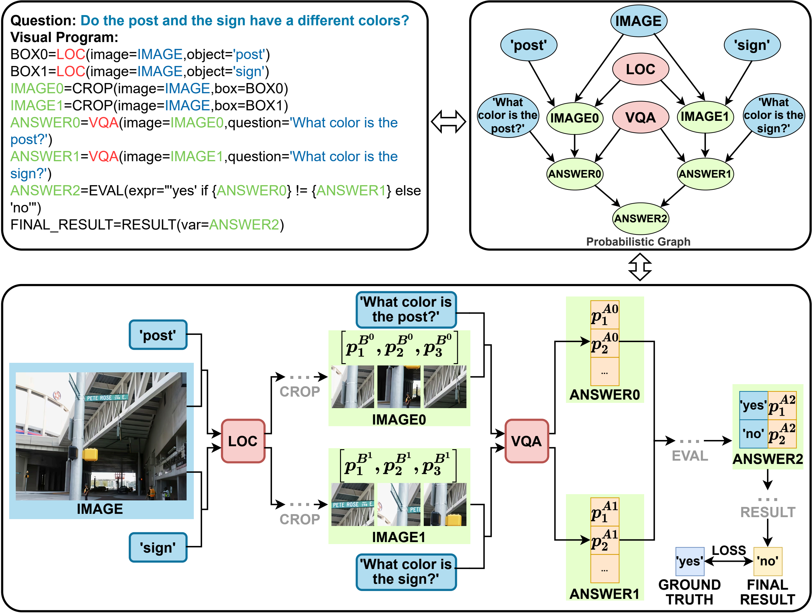

# eDoT

**End-to-End Differentiable Optimization of Tool-Augmented Visual Reasoning via Probabilistic Graphs**

Wentao Wan, Kaiyu Wu, Qingyang Ma, Nan Kang, Yunjie Chen, Liang Lin, Keze Wang

**Findings of EMNLP 2026** | [Paper](https://aclanthology.org/2026.findings-emnlp.2444/)

**English** | [简体中文](README_zh.md)

## Overview

eDoT optimizes visual tools within visual programs through probabilistic execution. Intermediate answers are represented by candidate probabilities, combined according to the program, and supervised using the final task label. This allows gradients from the final-answer loss to reach the invoked VQA model.



## Code structure

| Component | Source | Purpose |
|---|---|---|
| Program execution | [utils.py](visprog/engine/utils.py) | `Program` and `ProgramInterpreter`: program state and step dispatch. |
| Probability propagation | [step_interpreters.py](visprog/engine/step_interpreters.py) | Visual tool calls, image crops, EVAL probability aggregation and RESULT. |
| Training bridge | [run_code.py](visprog/run_code.py) | Connects training samples to program execution through `get_result_supervised`. |
| Model and loss | [modeling_internvl_chat.py](internvl/model/internvl_chat/modeling_internvl_chat.py) | InternVL candidate scoring, final-answer loss and LLM LoRA. |
| Data processing | [train/](internvl/train/) · [pad_data_collator.py](internvl/patch/pad_data_collator.py) | Image/text preprocessing and transmission of programs and final task labels to the model. |
| Prompts | [prompt.py](data_process/prompt.py) · [fallback prompt](visprog/prompts/gqa_fixed_code.prompt) | Original program-generation prompts and the single-step VQA fallback template. |

The main training path is:

```text
Training sample → InternVL forward → ProgramInterpreter
                → VQA candidate scores → EVAL / RESULT → final-answer loss
```

## Using the source

1. Prepare the corresponding **InternVL1.5 / VisProg environment** and a Mini-InternVL-Chat-2B-V1-5 checkpoint.
2. Place the files under `internvl/` into the matching paths under the upstream `InternVL/internvl_chat/internvl/` directory. Place `visprog/` alongside that directory, under `InternVL/internvl_chat/`.
3. Configure the checkpoint, annotations and image paths in the original training setup.

## Acknowledgments and licenses

- Program execution and crop operations build on [VisProg](https://github.com/allenai/visprog).
- Model and preprocessing code build on [InternVL](https://github.com/OpenGVLab/InternVL).

## Citation

If you use this code in research, please cite the eDoT paper named above and acknowledge the underlying projects.

```bibtex
@inproceedings{wan-etal-2026-end,
    title = "End-to-End Differentiable Optimization of Tool-Augmented Visual Reasoning via Probabilistic Graphs",
    author = "Wan, Wentao and Wu, Kaiyu and Ma, Qingyang and Kang, Nan and Chen, Yunjie and Lin, Liang and Wang, Keze",
    booktitle = "Findings of the {A}ssociation for {C}omputational {L}inguistics: {EMNLP} 2026",
    year = "2026",
    pages = "52467--52482",
}
```
